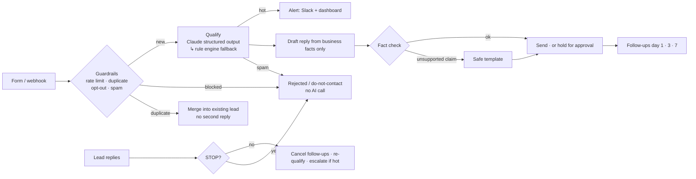

# LeadHub — an AI agent that answers new leads in seconds, safely

LeadHub takes a new lead from a form or webhook, decides how hot it is, replies within seconds using **only** the business's real facts, alerts a human about hot leads, follows up on day 1, 3 and 7, and stops the moment the lead replies or says STOP. Every automated decision is logged with its reason.

This is a clean, open re-implementation of the lead workflows I have built for clients (real-estate lead-to-revenue engine, AI SDR follow-up engine with sub-60-second first reply and hot-lead escalation). Client code is private; this repo shows the same patterns end to end on a fictional agency, **Harbor & Pine Realty**.

> Built by Godwin Camitan · https://godwincamitan.me

## Features

| | What it does | Where |
|---|---|---|
| **Intake** | Web form and a webhook endpoint (`POST /api/webhook/lead`) for Facebook Lead Ads / Zapier / n8n | `src/server.js` |
| **Guardrails before AI** | Duplicate person (same email in any case, or same phone) is merged, never contacted twice · spam and link-stuffing rejected before any model call · opt-out list is permanent · per-source rate limit · contact details masked in logs | `src/guard.js` |
| **AI qualification** | Hot / warm / cold / spam, score 0-100, intent, timeline, budget, area, next action, and a one-line reason — Claude structured output (zod schema) | `src/ai.js` |
| **Offline fallback** | Transparent rule engine when no API key is set or the model call fails — the pipeline never stops | `src/ai.js` → `ruleQualify` |
| **Grounded first reply** | Draft may use only facts from `config/business.json`; a second check rejects any price, commission, availability or promise not in the facts and falls back to a safe template (fails closed) | `src/ai.js` → `draftReply` |
| **Speed** | First reply time is measured per lead (median shown on the dashboard) | `src/pipeline.js` |
| **Hot-lead escalation** | Alert to Slack (incoming webhook) and the dashboard, with the reason and next step | `src/pipeline.js` |
| **Follow-up sequence** | Day 1, 3, 7 — cancelled automatically on reply, opt-out, won or lost | `src/pipeline.js` |
| **Reply handling** | Lead replies → follow-ups stop, lead is re-qualified with the full conversation, escalated if it became hot; "STOP" → do-not-contact forever | `src/pipeline.js` |
| **Human in the loop** | `REQUIRE_APPROVAL=true` holds every first reply for review and edit | `.env` |
| **Audit trail** | Every step (received, rejected, qualified, sent, escalated, scheduled, cancelled) with its reason, per lead | `src/db.js` |
| **Dashboard** | Pipeline board, lead drawer (score, reason, reply, follow-ups, conversation, audit), hot-lead feed, outbox — live via SSE | `public/` |
| **Evals** | Labelled lead set → accuracy + confusion matrix for both engines; end-to-end guardrail tests | `evals/` |

## Results

Qualification on the 20 labelled leads in `evals/leads.jsonl` (`npm run eval`):

| Engine | Correct | Hot leads lost to cold/spam |
|---|---|---|
| Claude (claude-haiku-5-5) | **20 / 20** | 0 |
| Rule engine (offline) | 19 / 20 | 0 (one hot rated warm) |

The rule engine was tuned on this same set, so expect lower accuracy on new data; the eval set is small and should grow with real, anonymised leads. Read it as a regression test, not a benchmark.

End-to-end guardrail tests (`npm test`): **13 / 13 pass** — duplicates merged with no second reply, spam stopped before any AI call, follow-ups sent when due and cancelled on reply, STOP blocks all future contact, every step audited.

## Architecture



**Design choices**
- **Rules in code, judgment in the model.** Duplicates, opt-outs, spam, rate limits and follow-up cancellation are deterministic. The model only classifies and writes.
- **Fail closed.** A reply that fails the fact check is never sent; a failed model call falls back to rules or a template rather than stopping the pipeline or sending something unchecked.
- **Explainable.** Every tier comes with a reason, and every automated action is in the lead's audit trail.
- **Swappable edges.** The outbox is simulated (`send()` in `pipeline.js`) — swap in SMTP, Twilio or WhatsApp. The JSON store is one file — swap in Postgres.

## Run it

```bash
npm install
cp .env.example .env          # API key optional — without it, the rule engine and templates are used
npm start                     # http://localhost:7788
npm run demo                  # in a second terminal: sends 8 realistic demo leads
npm test                      # end-to-end guardrail tests
npm run eval                  # qualification accuracy
```

`TIME_SPEED=1440` makes one "day" pass per minute so you can watch follow-ups go out during a demo.
